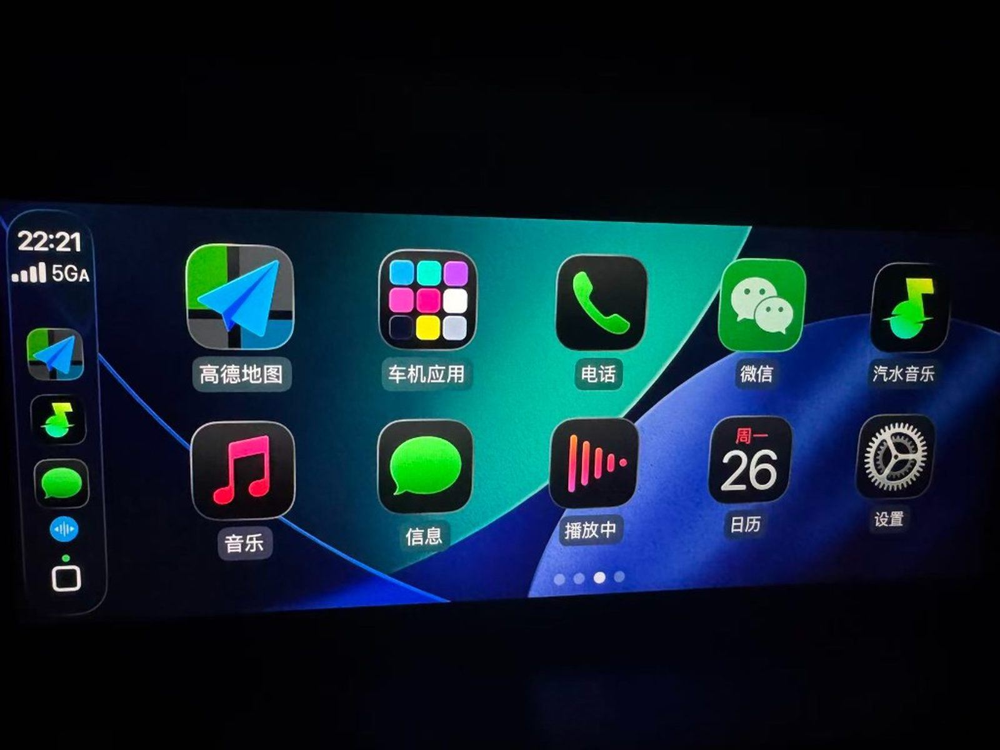
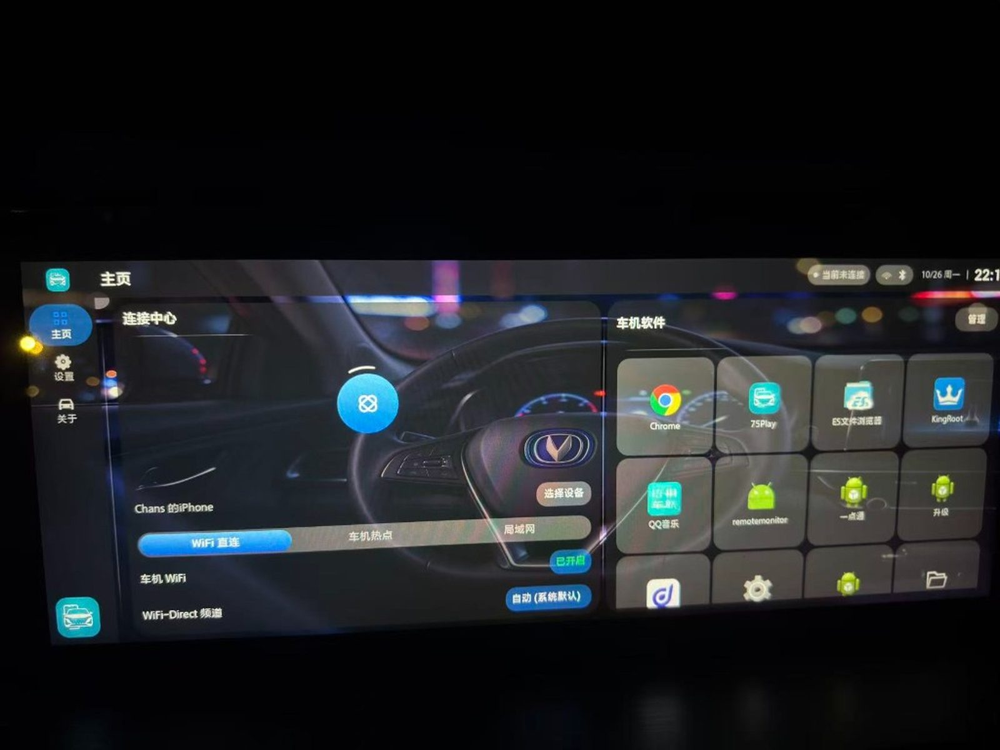
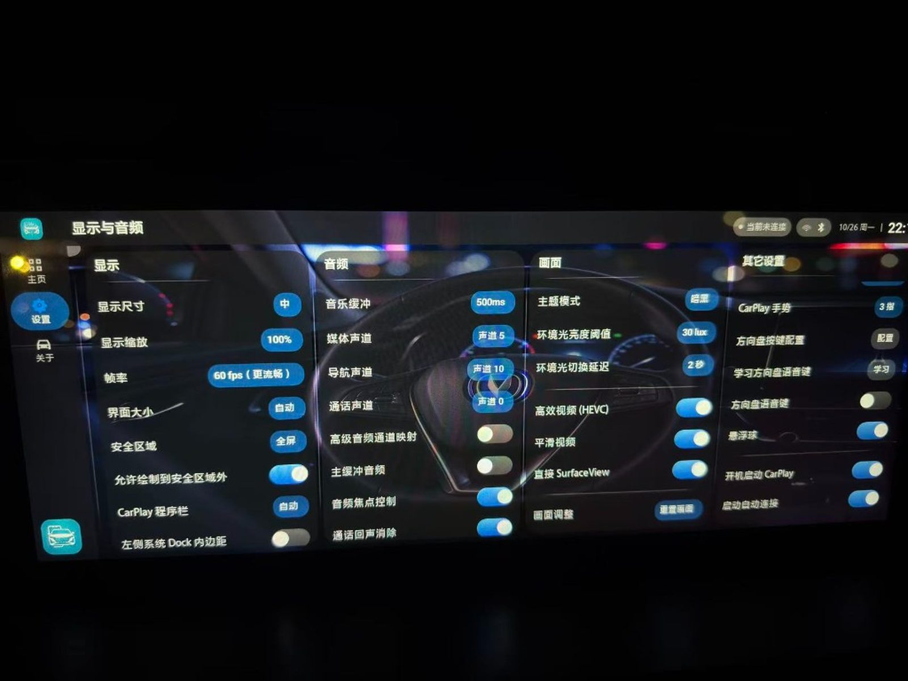
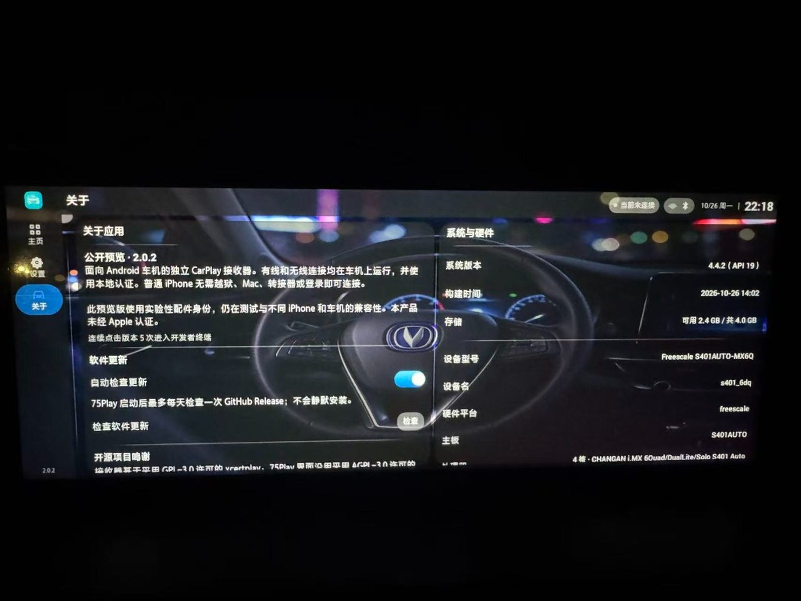

# 75Play

**把 iPhone 的 CarPlay，无线投到长安 CS75 Plus 2020 车机。**

面向原厂车机（`OS_S311-WT` · Android 4.4.2 / API 19 · `armeabi-v7a`）的开源无线 CarPlay 接收端。三种连接方式：Wi‑Fi Direct（默认）、车机热点（SoftAP）、局域网（Existing Wi‑Fi）；内置 MFi 认证材料，无需越狱、转接盒或账号。

> 独立实现，**非** Apple 认证，与 Apple / 长安无隶属关系。请在安全停车后操作。
>
> 基于 [DiPlay-Legacy-Android](https://github.com/programmerguohuajing/DiPlay-Legacy-Android) 修改优化。当前 **v2.0.2**，见 [CHANGELOG](CHANGELOG.md)。

[下载 APK](https://github.com/chansLam/75Play/releases) · [项目主页](https://chansLam.github.io/75Play/) · [English](README.en.md)

---

## 亮点

- **无线-only CarPlay** — Wi‑Fi Direct / 车机热点（SoftAP）/ 局域网；本车阉割 TUN，已移除 USB 有线
- **一键连接** — Wi‑Fi Direct / 车机热点切换即自动准备网络；局域网连上 Wi‑Fi 后自动进 CarPlay
- **全屏沉浸** — 宽屏适配；CarPlay 内打开车机应用；悬浮小白点返回
- **玻璃双主题 UI** — 主页与设置按司机目标分组
- **多语言** — 简 / 繁中文、英文、阿拉伯语、西班牙语、俄语、乌克兰语
- **安卓终端**（实验性）

## 实机截图 · v2.0.2

长安 CS75 Plus 2020 车机实机效果：

  
  
  
  

## 快速安装

1. 若装过**其他签名**的 75Play，先卸载。
2. 从 [Releases](https://github.com/chansLam/75Play/releases) 下载 APK，**安装到车机**（不是 iPhone）。
3. 打开 75Play，iPhone 保持蓝牙开启；在主页选连接方式：
   - **Wi‑Fi Direct** / **车机热点**：切换后会自动开 Wi‑Fi 或配置热点，再点 **连接 CarPlay**
   - **局域网**：选网并输入密码，连上 Wi‑Fi 后会**自动**连 CarPlay
4. 在 iPhone 上允许 CarPlay。

完整步骤与三种方式说明：[docs/INSTALL.md](docs/INSTALL.md)

## 文档

| 文档 | 说明 |
| --- | --- |
| [安装与使用](docs/INSTALL.md) | 目标机型、安装、连接、设置 |
| [构建与发布](docs/BUILD.md) | 环境、签名、Actions、应用内更新 |
| [安全与隐私](SECURITY.md) | 密钥、诊断、隐私约定 |
| [贡献指南](CONTRIBUTING.md) | Issue / PR 与本地检查 |
| [第三方致谢](docs/THIRD_PARTY_NOTICES.md) | 上游 tip 与许可摘要 |
| [版本说明](CHANGELOG.md) | 发布记录 |

## 范围

| 支持 | 不支持 |
| --- | --- |
| CS75 Plus **2020** · `OS_S311-WT` | 其他车机 / 年款 |
| 无线（Wi‑Fi Direct、车机热点 SoftAP、局域网） | USB 有线 CarPlay、TUN |
| `armeabi-v7a` | x86 / arm64 车机包 |

## 反馈

在 [Issues](https://github.com/chansLam/75Play/issues) 开单，并附上：

1. 「设置 → 诊断」导出的报告（`.txt`）
2. 车机固件、iPhone / iOS 版本
3. 复现步骤

**不要**附热点密码或配对材料。见 [SECURITY.md](SECURITY.md)。

## 协议与商标

- 源码：**GPL-3.0**（见 [`LICENSE`](LICENSE)）
- 部分 UI 衍生自 DiAuto（**AGPL-3.0**），见 [docs/THIRD_PARTY_NOTICES.md](docs/THIRD_PARTY_NOTICES.md)
- CarPlay 归 Apple Inc. 所有；使用本软件不代表 Apple 认证
